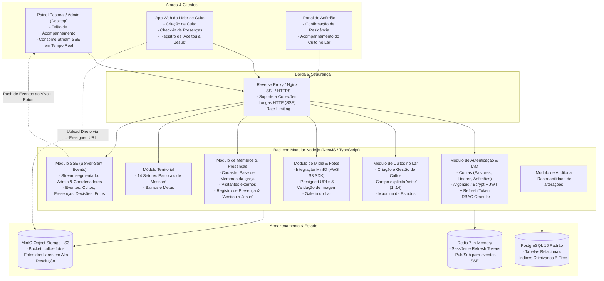
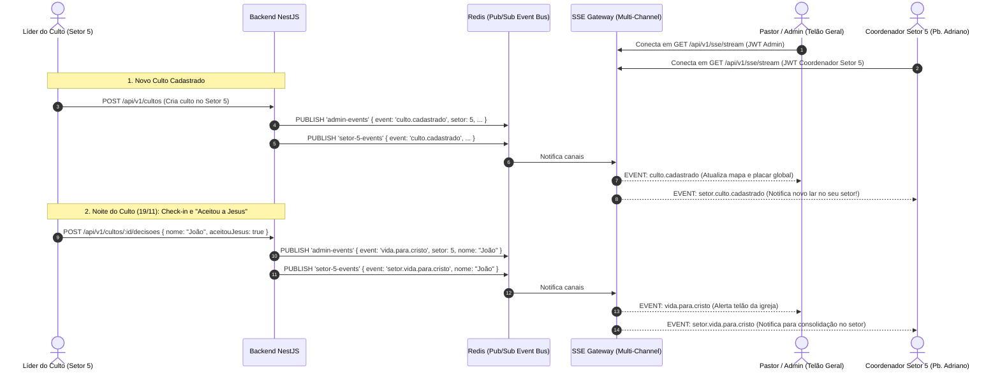
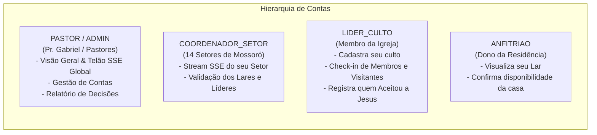
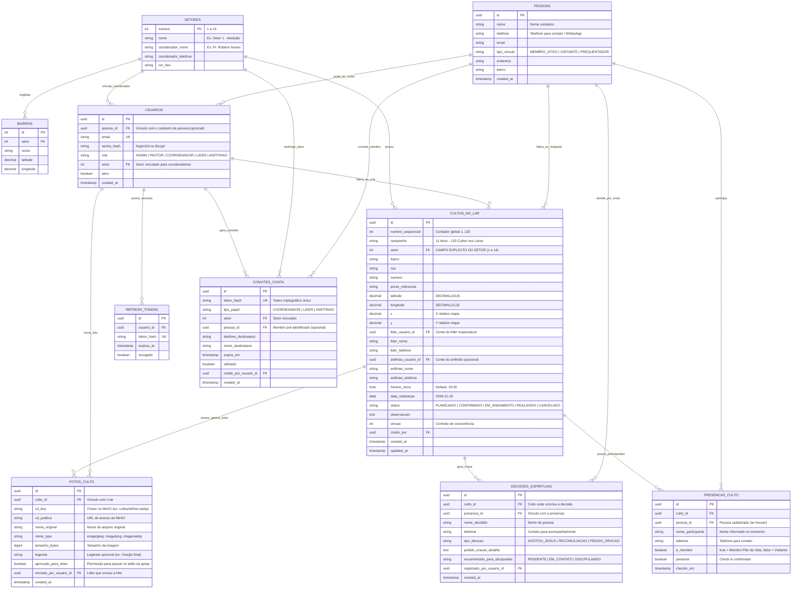
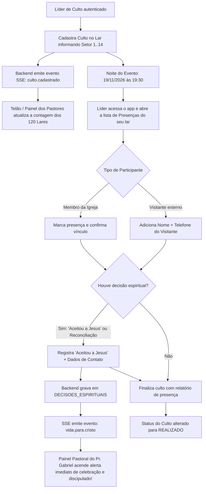
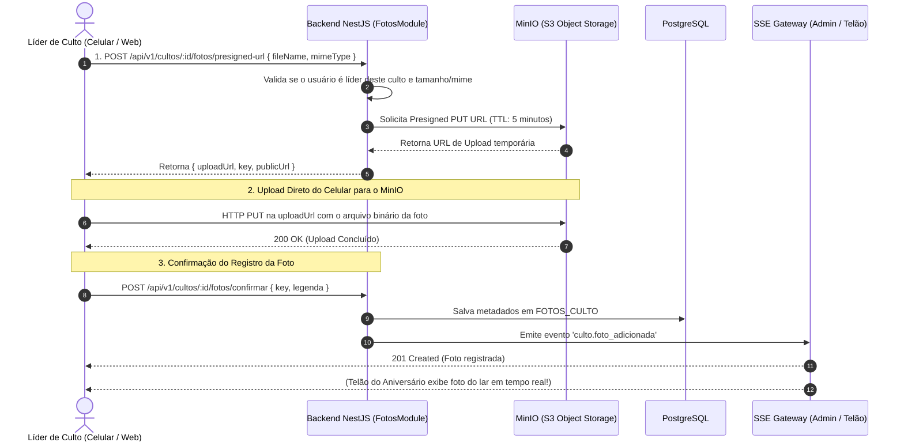
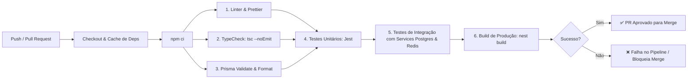
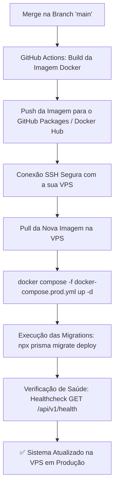

# Blueprint Arquitetural Completo: Sistema "120 Cultos nos Lares"
## Igreja Pão da Vida (Mossoró - RN) · 11 Anos

---

## 1. Visão Geral e Papel da Orquestração

Este documento define a **arquitetura de referência, modelagem conceitual, segurança, fluxos operacionais e eventos em tempo real** para o sistema dos 120 Cultos nos Lares da Igreja Pão da Vida.

### Decisões Arquiteturais Consolidadas:
* **Foco no Núcleo do Sistema:** Sem dependência de gateways externos pagos no momento (sem APIs pagas de WhatsApp/SMS).
* **Onboarding via Links de Convite Compartilháveis:** O Pastor gera links atrelados aos 14 setores e envia pelo WhatsApp para os Coordenadores; os Coordenadores visualizam os membros do seu setor e disparam links personalizados via WhatsApp para que os membros criem suas contas e recebam o papel de **Líder** ou **Anfitrião**.
* **Armazenamento de Mídia em MinIO (S3 Próprio):** Fotos dos cultos nos lares enviadas pelos líderes e armazenadas diretamente no bucket MinIO compatível com AWS S3 já hospedado pelo usuário.
* **Banco de Dados:** **PostgreSQL 16 Padrão Puro** (sem PostGIS), com o campo `setor` explícito na tabela e coordenadas decimais padrão.
* **Atualizações em Tempo Real via SSE Segmentado:** Pastores/Admins recebem o feed global de Mossoró e fotos ao vivo; Coordenadores recebem as atualizações do seu setor.
* **Contas Próprias para Cada Papel:** Pastores, Coordenadores, Líderes e Anfitriões possuem credenciais e painéis com permissões distintas.
* **Gestão de Membros vs. Visitantes:** Membros da igreja lideram e acolhem; registro detalhado de participantes com identificação de quem **"Aceitou a Jesus" (Novas Decisões / Reconciliações)** para fins de discipulado e consolidação pastoral.

---

## 2. Diagrama de Arquitetura de Alto Nível (C4 - Containers)



---

## 3. Arquitetura do SSE (Server-Sent Events) Segmentado (Admin & Coordenadores)

O **SSE (Server-Sent Events)** utiliza uma conexão HTTP unidirecional persistente (`text/event-stream`), muito mais leve que WebSockets para cenários de monitoramento contínuo onde os clientes apenas recebem dados.

### 3.1. Regras de Segurança e Segmentação por Perfil (Scoped Streams)
* **Endpoint:** `GET /api/v1/sse/stream`
* **Autenticação:** Token JWT validado no handshake inicial (via Header `Authorization: Bearer <token>` ou Cookie HttpOnly seguro).
* **Guarda de Autorização e Segmentação (Guard):**
  * **`ADMIN` / `PASTOR`:** Inscreve-se no canal global (`admin-events`), recebendo o panorama de toda a cidade de Mossoró (todos os 14 setores).
  * **`COORDENADOR`:** Inscreve-se automaticamente no canal do seu setor (`setor-{numero}-events`) E no canal de comunicados gerais (`broadcast-events`), sem poluição de dados de outros setores.
  * **Demais perfis (`LIDER`, `ANFITRIAO`):** Acesso negado com `403 Forbidden`.

### 3.2. Catálogo de Eventos Transmitidos no SSE



| Nome do Evento | Destinatários | Dados Enviados |
| :--- | :---: | :--- |
| `culto.cadastrado` | Admin e Coordenador do Setor | ID, Setor, Bairro, Endereço, Nome do Líder, Nome do Anfitrião |
| `meta.progresso` | Admin e Coordenador do Setor | Total geral (120 lares) e total específico do setor do coordenador |
| `culto.alerta_pendencia`| Coordenador do Setor | Culto sem anfitrião confirmado ou sem líder definido no setor |
| `culto.iniciado` | Admin e Coordenador do Setor | Culto que iniciou a reunião e total de participantes no check-in |
| `vida.para.cristo` | Admin e Coordenador do Setor | Nome da pessoa que aceitou a Jesus, telefone, bairro e lar onde ocorreu |
| `comunicado.pastoral` | Admin e Todos os Coordenadores | Mensagem em broadcast enviada pelo Pastor Gabriel para a liderança |

---

## 4. Gestão de Contas, Papéis e Matriz de Permissões (RBAC)

Cada perfil possui sua própria conta de acesso com funcionalidades específicas:



### Matriz Detalhada de Permissões:

| Funcionalidade | ADMIN / PASTOR | COORDENADOR | LÍDER DE CULTO | ANFITRIÃO |
| :--- | :---: | :---: | :---: | :---: |
| **Acessar Stream SSE em Tempo Real** | ✅ **Global (Toda Cidade)** | ✅ **Do seu Setor + Avisos** | ❌ Não | ❌ Não |
| **Gerenciar Contas de Usuários** | ✅ Cria/Edita contas | ❌ Não | ❌ Não | ❌ Não |
| **Cadastrar Culto no Lar** | ✅ Qualquer setor | ✅ No seu setor | ✅ No seu lar/designado | ❌ Não |
| **Editar Dados do Culto** | ✅ Todos | ✅ Do seu setor | ✅ Apenas seu culto | ❌ Apenas obs da casa |
| **Registrar Lista de Presença** | ✅ Todos | ✅ Do seu setor | ✅ Do seu culto | ❌ Não |
| **Registrar "Aceitou a Jesus"** | ✅ Todos | ✅ Do seu setor | ✅ Do seu culto | ❌ Não |
| **Visualizar Relatório de Decisões**| ✅ Total consolidado | ✅ Do seu setor | ❌ Apenas do seu culto | ❌ Não |
| **Exportar Planilhas (CSV/Excel)** | ✅ Cidade inteira | ✅ Do seu setor | ❌ Não | ❌ Não |

---

## 5. Modelagem de Dados Relacional Completa (PostgreSQL Padrão)

O esquema atende perfeitamente à separação de **Membros da Igreja**, **Visitantes**, **Presença** e **Decisões Espirituais**:



---

## 6. Fluxo de Vida do Culto & Acompanhamento Espiritual



---

## 7. Arquitetura de Upload e Armazenamento de Fotos com MinIO (S3 Próprio)

Para suportar o envio de fotos dos 120 lares em tempo real sem sobrecarregar o tráfego do Node.js, adotamos o padrão de **URLs Pré-assinadas (Presigned URLs)** via `@aws-sdk/client-s3` conectado ao **MinIO** do usuário:



### Vantagens Desta Abordagem:
1. **Zero Sobrecarga de Memória no Backend:** O streaming binário de fotos de 5MB–10MB vai direto do celular para o MinIO, sem consumir CPU e RAM da API NestJS.
2. **Compatibilidade com S3:** Utiliza a SDK padrão da AWS apontando para o endpoint do MinIO local (`s3Client = new S3Client({ endpoint: MINIO_ENDPOINT, credentials: ... })`).
3. **Curadoria para o Telão da Igreja:** A coluna `aprovado_para_telao` permite aos pastores/mídia selecionar as fotos mais marcantes dos lares para projetar durante o culto de celebração na sede da igreja.

---

## 8. Mapeamento de Endpoints da API REST Atualizada

### Autenticação & Gestão de Contas (`/api/v1/auth` e `/api/v1/usuarios`)
* `POST /api/v1/auth/login` -> Login com email e senha (retorna JWT e Refresh Token).
* `POST /api/v1/auth/refresh` -> Renovação de token de acesso.
* `POST /api/v1/auth/logout` -> Encerramento da sessão.
* `GET  /api/v1/auth/me` -> Perfil da conta conectada e role ativa.
* `POST /api/v1/usuarios` -> *(Admin/Pastor)* Cria nova conta manual.
* `GET  /api/v1/usuarios` -> *(Admin/Pastor)* Lista contas com filtros por role e setor.

### Convites e Onboarding via WhatsApp (`/api/v1/convites`)
* `POST /api/v1/convites/coordenador` -> *(Pastor)* Gera link de convite atrelado a um dos 14 setores para envio via WhatsApp.
* `POST /api/v1/convites/membro` -> *(Coordenador/Pastor)* Gera link para membro do setor criar conta e atribui papel (`LIDER`, `ANFITRIAO` ou `AMBOS`).
* `GET  /api/v1/convites/validar` -> *(Público via Link)* Valida token criptográfico e retorna dados pré-preenchidos da igreja e setor.
* `POST /api/v1/convites/ativar` -> *(Público via Link)* Cria a conta, define a senha e ativa o acesso no sistema.
* `GET  /api/v1/convites/setor/:setorId` -> *(Coordenador/Admin)* Lista status de convites (pendentes/utilizados) com opção de reenvio.

### Stream em Tempo Real (`/api/v1/sse`)
* `GET /api/v1/sse/stream` -> **Exclusivo para ADMIN, PASTOR e COORDENADOR**. Stream contínuo segmentado:
  * Admins/Pastores recebem o feed global de Mossoró (incluindo fotos ao vivo).
  * Coordenadores recebem os eventos específicos do seu setor (1..14) e comunicados da liderança.

### Cultos nos Lares (`/api/v1/cultos`)
* `POST   /` -> *(Líder/Coordenador/Admin)* Cria novo culto com campo `setor` (1..14).
* `GET    /` -> Lista de cultos com paginação e filtros (`setor`, `bairro`, `status`).
* `GET    /:id` -> Detalhes completos do culto e anfitrião.
* `PUT    /:id` -> Atualização das informações da casa/líder.
* `PATCH  /:id/status` -> Transição de status (`PLANEJADO`, `CONFIRMADO`, `REALIZADO`, `CANCELADO`).

### Galeria de Fotos & MinIO S3 (`/api/v1/cultos/:id/fotos`)
* `POST   /:id/fotos/presigned-url` -> *(Líder)* Gera URL pré-assinada de upload direto no MinIO.
* `POST   /:id/fotos/confirmar` -> *(Líder)* Salva metadados da foto após upload no MinIO e emite SSE.
* `GET    /:id/fotos` -> Lista a galeria de fotos do culto no lar.
* `PATCH  /fotos/:fotoId/telao` -> *(Admin/Mídia)* Aprova ou reprova foto para exibição no telão.
* `DELETE /fotos/:fotoId` -> *(Líder/Admin)* Remove foto do MinIO e banco.

### Presenças e "Aceitou a Jesus" (`/api/v1/cultos/:id/presencas` e `decisoes`)
* `GET  /:id/presencas` -> Lista de quem está confirmado no lar.
* `POST /:id/presencas` -> Check-in de membro ou visitante (Nome, Telefone, `e_membro: boolean`).
* `POST /:id/decisoes` -> **Registro de decisão ("Aceitou a Jesus" / Reconciliação)**. Dispara evento instantâneo no SSE dos Pastores.
* `GET  /api/v1/relatorios/decisoes` -> *(Admin/Pastor)* Relatório consolidado para o ministério de consolidação e discipulado.

### Territorial & Metas (`/api/v1/setores` e `/api/v1/metas`)
* `GET /api/v1/setores` -> Lista dos 14 setores e seus coordenadores.
* `GET /api/v1/metas/progresso` -> Contador dos 120 cultos e resumo por setor.
* `GET /api/v1/metas/exportar/csv` -> Download da planilha completa com dados de líderes, anfitriões e totais.

---

## 9. Modelagem do Repositório e Pipeline CI/CD (GitHub Actions)

Para garantir qualidade contínua, governança e deploy seguro, modelamos a estrutura do repositório e os fluxos automatizados de integração e entrega contínua:

### 9.1. Organização do Repositório (Monorepo Limpo)
```
/
├── .github/
│   ├── workflows/
│   │   ├── ci.yml                     # Pipeline de Integração Contínua (Lint, Testes, Build)
│   │   └── cd.yml                     # Pipeline de Deploy Contínuo (Docker Build & Release)
│   └── pull_request_template.md       # Checklist de PR (regras de negócio e cobertura)
│
├── backend/                           # API REST Modular NestJS
│   ├── src/                           # Código-fonte (Clean Architecture)
│   ├── prisma/                        # Schemas e Migrations do PostgreSQL
│   ├── test/                          # Testes unitários e e2e
│   ├── Dockerfile                     # Imagem de produção multi-stage otimizada
│   ├── docker-compose.yml             # Ambiente local (PostgreSQL 16 + Redis 7)
│   └── package.json
│
├── frontend/                          # Aplicação Web dos Cultos no Lar
│   └── ...                            # Componentes, mapas e telas
│
├── docs/                              # Documentações e diagramas
├── .gitignore                         # Ignora node_modules, .env, dist, etc.
└── README.md                          # Guia de onboarding para desenvolvedores
```

### 9.2. Estratégia de Branches & Commits
* **Estratégia Simplificada (Single-Environment / Main-Only Deploy):**
  * Sem ambiente de homologação no momento para manter a operação enxuta e direta.
  * `main`: Branch principal de produção. Toda mesclagem aprovada na `main` dispara o deploy imediato para a VPS.
  * `feature/*` e `fix/*`: Branches de desenvolvimento onde o desenvolvedor trabalha e abre Pull Request para a `main`. O CI roda no PR para garantir que nada quebrado chegue à `main`.
* **Padrão de Commits (Conventional Commits):**
  * `feat(auth): adiciona fluxo de convite via token para coordenador`
  * `fix(cultos): corrige validacao de setor 1..14 no cadastro`
  * `test(presencas): adiciona testes unitarios de registro de decisao espiritual`

---

### 9.3. Fluxo de CI (Integração Contínua - `.github/workflows/ci.yml`)

O CI roda automaticamente em **todos os Pull Requests** e em qualquer push para a branch `main`:



#### Especificação Técnica do Job de CI:
1. **Ambiente:** `ubuntu-latest` com Node.js 22.
2. **Serviços no CI (Containers):**
   * PostgreSQL 16 (`image: postgres:16-alpine`) para testes reais de migrations.
   * Redis 7 (`image: redis:7-alpine`) para validar o Pub/Sub de SSE.
3. **Passos Automatizados:**
   * `Lint`: Validação estrita de padrões de código (sem `any` desnecessário).
   * `TypeCheck`: Compilação TypeScript em modo de verificação sem emitir arquivos.
   * `Prisma Schema Validation`: Garante que as migrations e modelos relacionais estão íntegros.
   * `Testes com Cobertura`: Execução de suíte de testes unitários de casos de uso com relatório de cobertura.
   * `Build Check`: Garante que a aplicação compila 100% sem erros de empacotamento.

---

### 9.4. Fluxo de CD e Deploy na VPS (`.github/workflows/cd.yml`)

Como toda a aplicação rodará na **sua VPS própria** (onde o MinIO já está operando), o deploy é automatizado de ponta a ponta via GitHub Actions conectando à VPS por SSH:



#### Configuração de Borda na VPS (Nginx Otimizado para SSE e MinIO):
Para que as conexões de **SSE (Server-Sent Events)** para os Pastores e Coordenadores não sofram *timeout* ou fiquem presas em *buffer* no Nginx da VPS:
```nginx
# Configuração Nginx na VPS para a API e SSE
location /api/v1/sse/ {
    proxy_pass http://backend:3000;
    proxy_http_version 1.1;
    proxy_set_header Connection '';
    proxy_set_header Host $host;
    
    # CRUCIAL PARA SSE NA VPS:
    proxy_buffering off;
    proxy_cache off;
    chunked_transfer_encoding off;
    proxy_read_timeout 86400s; # Conexão contínua de até 24h
}
```

### 9.5. Dockerfile Multi-Stage de Produção (Segurança e Performance)
Para garantir que a imagem Docker seja leve (~120MB) e segura:
* **Stage 1 (Builder):** Instala dependências completas, compila TypeScript com NestJS e gera client do Prisma.
* **Stage 2 (Runner):** Copia apenas o diretório `dist/` compilado e dependências de produção (`--omit=dev`).
* **Segurança:** A aplicação roda sob um usuário sem privilégios de root (`USER node`).

---

## 10. Governança e Próximos Passos

Com esta modelagem refinada, o plano de execução está 100% definido:
* ✅ **Fase 1: Arquitetura & Modelagem (Concluída)**
* ⏳ **Fase 2: Infraestrutura Base (Docker Compose PostgreSQL 16 + Redis + Setup NestJS)**
* ⏳ **Fase 3: Prisma Schema com as novas tabelas (`usuarios`, `cultos_no_lar`, `presencas_culto`, `decisoes_espirituais`, `fotos_culto`, `setores`) e Adaptador MinIO S3**
* ⏳ **Fase 4: Implementação do Módulo de Auth (Contas próprias com Argon2/JWT) e SSE Guard**
* ⏳ **Fase 5: Casos de Uso de Cultos, Presenças e Decisões Espirituais**
* ⏳ **Fase 6: Painel e Integração com Frontend**
